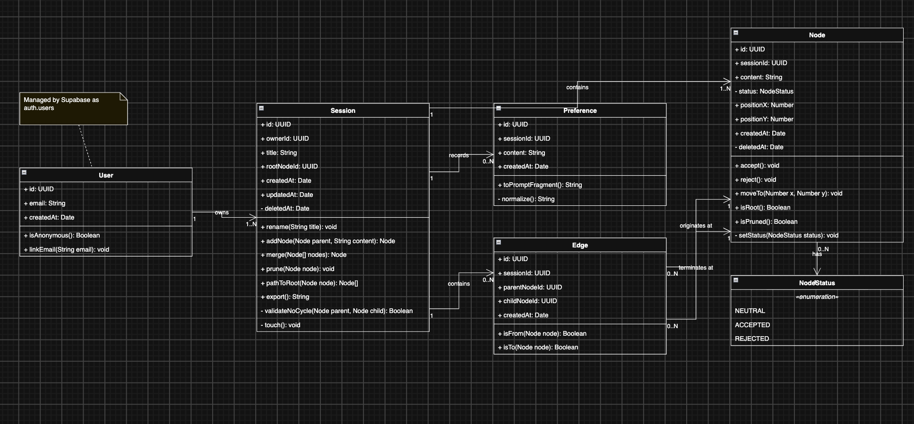

# PATHFINDERS

## Software Requirements Specification

**Instructor:** Lara Nichols-Brown  
**Term:** Fall 2026  
**Section:** CSC-3100-S03-2268

### Engineering Team

1. **Cole Edmonston** - Lead Engineer
2. **Ethan Ikenaga** - Product Owner
3. **Jonah Depaz** - Scrum Master
4. **Tyler Kim** - Tester

### Project Assets

- **GitHub:**
  https://github.com/ino464/CSC-3100-Software-Engineering-Project
- **Deployment:** WIP

### Document History

| Last Date Changed | Who           | What Was Changed                                                                                                                                                                        |
| ----------------- | ------------- | --------------------------------------------------------------------------------------------------------------------------------------------------------------------------------------- |
| 2026-11-12        | Ethan Ikenaga | Amended the SRD to match the implementation (#76): fixed the section 3 table, updated requirements for like/dislike flags, soft delete, and session rename, wrote sections 4.2, 5, and 7, listed export as implemented, and filled in the traceability matrix with real files. |
| 2026-10-13        | Ethan Ikenaga | Replaced template workout requirements in section 3 with functional requirements traced to US-01 to US-12; rebuilt the section 8 traceability matrix; changed MySQL to Postgres in 5.2. |
| 2026-09-25        | Ethan Ikenaga | Drafted the SRD and entered user stories US-01 to US-12.                                                                                                                                |

---

# PATHFINDERS

## Software Requirements Specification (SRS)

**Course:** CSC-3100-S03-2268 **Date:** [Submission Date]

---

## Table of Contents

1. [Introduction](#1-introduction)

   - [1.1 Project Purpose](#11-project-purpose)
   - [1.2 Intended Audience](#12-intended-audience)
   - [1.3 Project Scope](#13-project-scope)

2. [User Stories](#2-user-stories)

   - [2.1 User Features](#21-user-features)
   - [2.2 Admin Features](#22-admin-features)

3. [Functional Requirements](#3-functional-requirements)
4. [Non-Functional Requirements](#4-non-functional-requirements)

   - [4.1 Data Integrity and Security](#41-data-integrity-and-security)
   - [4.2 Performance and Usability](#42-performance-and-usability)

5. [System Architecture](#5-system-architecture)

   - [5.1 REST API Endpoints](#51-rest-api-endpoints)
   - [5.2 Database Schema](#52-database-schema)

6. [User Interface](#6-user-interface-ui)

   - [6.1 Wireframes / Mockups](#61-wireframes--mockups)

7. [Data Requirements](#7-data-requirements)

   - [7.1 List of Persistent Data](#71-list-of-persistent-data)

8. [Traceability Matrix](#8-traceability-matrix)
9. [Appendices](#9-appendices)
10. [AI Usage and Disclosure](#10-ai-usage--disclosure-mandatory)

---

## 1. Introduction

### 1.1 Project Purpose

**Problem Statement:** What specific problem are you solving?

This project solves the problem that normal AI chats are hard to
use for brainstorming. When you explore many ideas in one chat,
good ideas get buried and it is difficult to go back to earlier
options. With our visual canvas, users can easily merge ideas,
go back to previous nodes, and find chats easily.

**Product Vision:** For students, developers, and anyone who
needs to explore many ideas without losing the good ones,
PATHFINDERS is a visual AI brainstorming canvas that turns a
single prompt into connected branches of ideas, so every
direction stays organized and easy to revisit. Unlike a standard
linear AI chat, where earlier options get buried, PATHFINDERS
lets users branch from any idea, return to earlier ideas, and
merge branches together.

### 1.2 Intended Audience

**Target Audience:** Who are the stakeholders?

The main users are people who need help brainstorming and
organizing ideas, such as students, developers, designers,
entrepreneurs, and anyone planning a project or making a
decision.

### 1.3 Project Scope

What is the scope of this project?

We plan to have users create an account, start a brainstorming
session, enter a prompt, and see AI-generated ideas as connected
branches on a visual canvas. They can explore any branch, save
sessions, return to earlier ideas, and mark ideas as useful or
not useful. Other features such as merging ideas can come if
time permits.

---

## 2. User Stories

User stories follow this format:

> As a **[type of user]**, I want to **[action]** so that
> **[value/benefit]**.

### 2.1 User Features

| ID    | Author | User Story                                                                                                                                                                        | Priority |
| ----- | ------ | --------------------------------------------------------------------------------------------------------------------------------------------------------------------------------- | -------: |
| US-01 | Jonah  | As a brainstormer/user, I want the system to suggest and automatically create new branches based on a node’s context so that I can explore multiple directions from an idea.      |        1 |
| US-02 | Jonah  | As a brainstormer/user, I want to add new nodes to a selected chat branch using the branch’s existing context so that each idea path develops independently.                      |        1 |
| US-03 | Cole   | As a brainstormer/user, I want to be able to click through all my chat history to easily switch between different idea branches, in order to work through multiple ideas at once. |        1 |
| US-04 | Ethan  | As a returning user, I want to be able to login so that i can continue where I left off                                                                                           |        2 |
| US-05 | Ethan  | As a brainstormer, I want to be able to accept and reject nodes so that I can keep track of my decisions                                                                          |        2 |
| US-06 | Ethan  | As a brainstormer, I would like to return to a previous node so I can reimagine an idea                                                                                           |        2 |
| US-07 | Cole   | As a brainstormer/user, I want to be able to delete/deactivate branches and chats I no longer find useful or helpful in order to keep my work space organized.                    |        2 |
| US-08 | Tyler  | As a brainstormer, I want to be able to put in preferences that the program persists through my brainstorming session so that my likes/dislikes are remembered.                   |        3 |
| US-09 | Cole   | As a brainstormer/user, I want to be able to update the chat names to a relevant idea so that it is easier to reference and is more memorable for myself.                         |        3 |
| US-10 | Jonah  | As a brainstormer/user, I want to be able to export my brainstorm graph so I can share it with other collaborators for later use.                                                 |        3 |
| US-11 | Tyler  | As a teammate of a brainstormer, I want to be able to see and import someone else’s brainstorm graph through some export function in order to be sure we’re on the same page.     |        3 |
| US-12 | Tyler  | As a brainstormer, I want to be able to select two or more nodes and merge them so I can see a combination of my ideas.                                                           |        4 |

### 2.2 Admin Features

There are no Admin features currently in Pathfinders

---

## 3. Functional Requirements

The system shall:

Each requirement's priority is the priority of the user story it traces to (see [2.1](#21-user-features)).

| ID    | Requirement                                                                                                    | User Story                 |
| ----- | -------------------------------------------------------------------------------------------------------------- | -------------------------- |
| FR-01 | The system shall suggest and automatically create new branches based on the context of a selected node.        | [US-01](#21-user-features) |
| FR-02 | The system shall allow users to add new nodes to a selected chat branch, using that branch's existing context. | [US-02](#21-user-features) |
| FR-03 | The system shall let users view their full chat history and switch between idea branches.                      | [US-03](#21-user-features) |
| FR-04 | The system shall allow returning users to log in and resume their previous brainstorming work.                 | [US-04](#21-user-features) |
| FR-05 | The system shall allow users to accept or reject nodes and shall record each decision.                         | [US-05](#21-user-features) |
| FR-06 | The system shall allow users to return to a previous node in order to develop that idea in a new direction.    | [US-06](#21-user-features) |
| FR-07 | The system shall allow users to delete or deactivate branches and chats.                                       | [US-07](#21-user-features) |
| FR-08 | The system shall allow users to enter preferences and shall apply them throughout the brainstorming session.   | [US-08](#21-user-features) |
| FR-09 | The system shall allow users to rename chats.                                                                  | [US-09](#21-user-features) |
| FR-10 | The system shall allow users to export a brainstorm graph so it can be shared.                                 | [US-10](#21-user-features) |
| FR-11 | The system shall allow users to import a brainstorm graph that another user exported.                          | [US-11](#21-user-features) |
| FR-12 | The system shall allow users to select two or more nodes and merge them into a combined node.                  | [US-12](#21-user-features) |

---

---

## 4. Non-Functional Requirements

### 4.1 Data Integrity and Security

- **Integrity:** The system shall handle errors and invalid data
  appropriately. Invalid requests get a `400` response, the
  database refuses node statuses other than `pending`,
  `accepted` and `rejected`, and the system refuses any link
  between nodes that would create a loop.
- **Security:** Passwords shall be handled by Supabase Auth. The
  application shall not store or hash passwords itself.
- **Security:** Server-side code shall read secrets (the
  Supabase keys and the Groq API key) from environment
  variables, not from source code.

### 4.2 Performance and Usability

- **Performance:** A request to the language model shall time
  out after 15 seconds and report an error.
- **Performance:** Each session shall be limited to 10 idea
  requests per 10 minutes, to control model cost and abuse.
- **Usability:** A returning visitor with a valid session shall
  go straight to the app without choosing a sign-in method again.

---

## 5. System Architecture

Pathfinders has no separate backend service. The backend is
server-side code inside a Next.js application, hosted on Vercel.
Supabase provides the PostgreSQL database and authentication.
Groq provides the language model used for idea generation.

### 5.1 REST API Endpoints

| Method | URL              | Description                        |
| ------ | ---------------- | ---------------------------------- |
| POST   | `/api/expand`             | Generates ideas from a selected node and returns the new `{ nodes, edges }`. Needs a signed-in user.                                     |
| GET    | `/sessions/[id]/export`   | Downloads a session as a JSON file. Format: `docs/session-export-format.md`.                                                             |
| GET    | `/auth/callback`          | Finishes sign-in after an email link or Google redirect.                                                                                 |
| POST   | `/api/auth/merge/start`   | Starts moving a guest's sessions into an account.                                                                                        |
| POST   | `/api/auth/merge/finish`  | Finishes moving a guest's sessions into an account.                                                                                      |

`POST /api/expand` answers:

| Status | When                                                                                                       |
| ------ | ---------------------------------------------------------------------------------------------------------- |
| `201`  | The ideas were added.                                                                                      |
| `400`  | The body is not JSON, an id is not a UUID, or the instruction is not a string of at most 500 characters.   |
| `401`  | Nobody is signed in.                                                                                       |
| `404`  | The node is not in the session, is deleted, or the session belongs to another user.                        |
| `429`  | The session reached the idea limit.                                                                        |
| `502`  | The model request failed or its answer was not valid.                                                      |
| `504`  | The model did not answer in time.                                                                          |
| `500`  | Any other error.                                                                                           |

### 5.2 Database Schema

The database is PostgreSQL, hosted through Supabase.  Users are
Supabase's `auth.users`. We define four tables:

- **sessions**: one brainstorm. Columns: `id`, `user_id`, `title`,
  `root_node_id`, `created_at`, `updated_at`, `deleted_at`.
- **nodes**: one idea. Columns: `id`, `session_id`, `content`,
  `status`, `position_x`, `position_y`, `created_at`, `deleted_at`.
- **edges**: a link from a parent node to a child node. Columns:
  `id`, `session_id`, `parent_node_id`, `child_node_id`,
  `created_at`. Edges are their own table so a merged node can
  have more than one parent.
- **preferences**: a standing instruction for a session. Columns:
  `id`, `session_id`, `content`, `created_at`.

Every table has row-level security. A database function,
`add_children`, writes the children of a node and their edges in
one transaction. Design reasoning is in `docs/UML.md`.

---

## 6. User Interface (UI)

### 6.1 Wireframes / Mockups

See UI Storyboard here:
https://www.figma.com/design/zgO8ysGMhs7Lumws6jWTlF/Pathfinders-UI-Storyboard?node-id=0-1&t=EF9jjRfFyvBGnYQE-1

---

## 7. Data Requirements

### 7.1 List of Persistent Data

List the data that will be stored persistently in the database.

- User accounts, including guests (Supabase `auth.users`).
- Sessions: title, owner, root node, timestamps, and a deleted
  marker.
- Nodes: text, status (`pending`, `accepted` or `rejected`),
  timestamps, and a deleted marker. Position columns exist but
  are not used yet.
- Edges: which node each node came from.
- Preferences: the text of each preference and its session.

Deleted sessions and nodes are marked, not removed.

---

## 8. Traceability Matrix

| User Story | Requirement          | Main Code                                                                            | Status      |
| ---------- | -------------------- | ------------------------------------------------------------------------------------ | ----------- |
| US-01      | FR-01 (Expand)       | [expand.js:136](../packages/frontend/lib/expand.js#L136)                             | Implemented |
| US-02      | FR-02 (Add/edit)     | [node-actions.js:45](../packages/frontend/app/sessions/%5Bid%5D/node-actions.js#L45) | Implemented |
| US-03      | FR-03 (Sessions)     | [session-graph.jsx:65](../packages/frontend/app/session-graph.jsx#L65)               | Implemented |
| US-04      | FR-04 (Sign in)      | [auth-provider.js:49](../packages/frontend/app/auth-provider.js#L49)                 | Implemented |
| US-05      | FR-05 (Like/dislike) | [node-actions.js:62](../packages/frontend/app/sessions/%5Bid%5D/node-actions.js#L62) | Implemented |
| US-06      | FR-06 (Return)       | [TODO]                                                                               | [TODO]      |
| US-07      | FR-07 (Delete)       | [graph-data.js:438](../packages/frontend/lib/graph-data.js#L438)                     | Implemented |
| US-08      | FR-08 (Preferences)  | [actions.js:65](../packages/frontend/app/sessions/actions.js#L65)                    | Implemented |
| US-09      | FR-09 (Rename)       | [actions.js:44](../packages/frontend/app/sessions/actions.js#L44)                    | Implemented |
| US-10      | FR-10 (Export)       | [session-export.js:29](../packages/frontend/lib/session-export.js#L29)               | Implemented |
| US-11      | FR-11 (Import)       | Not started                                                                          | Planned     |
| US-12      | FR-12 (Merge nodes)  | Not started                                                                          | Planned     |

---

## 9. Appendices

- `docs/UML.md`: data model and the reasoning behind it
- `docs/backend-architecture.md`: backend decisions, data access
  layer, access control
- `docs/auth.md`: sign-in methods and guest merge
- `docs/session-export-format.md`: export file format
- `docs/context-assembly-cases.md` and
  `docs/expansion-instruction.md`: how ideas are generated
- `docs/images/`: sequence diagrams for sign-up, sign-in and
  backend calls

---

## 10. AI Usage & Disclosure (Mandatory)

- **Model(s) Used:** [Example: GPT-4o, Claude 3.5]
- **Prompts Used During Coding:** [Describe prompts or link to a
  record of them.]
